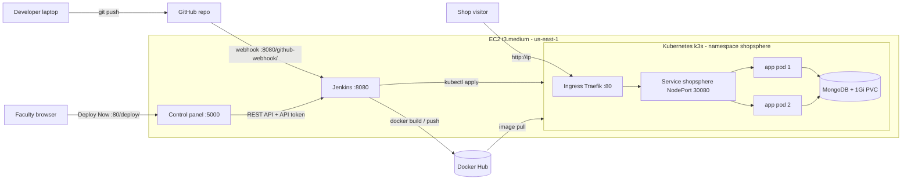

# 02 – Architecture

## One-paragraph summary

A single AWS EC2 instance runs Jenkins, Docker, a one-node Kubernetes cluster (k3s) and the Deploy Now control panel.
Code lives on GitHub. A push (webhook) or a click on Deploy Now starts the Jenkins pipeline, which tests the code inside
Docker, builds a versioned image, pushes it to Docker Hub and tells Kubernetes to roll it out. Kubernetes runs two copies
of the app plus MongoDB and exposes the shop on port 80 through the built-in Traefik Ingress.

## Diagram

## Ports (security group inbound)

| Port | Service | Who uses it |
| --- | --- | --- |
| 22 | SSH | Student / Claude Code |
| 80 | Shop website (Traefik Ingress) and Deploy Now panel at `/deploy/` | Everyone: **the main address** |
| 8080 | Jenkins (UI + GitHub webhook) | Student, GitHub |
| 5000 | Deploy Now control panel (direct, backup) | Faculty, if port 5000 is not blocked |
| 30080 | Shop website (NodePort, backup) | Optional |

## Kubernetes objects (namespace `shopsphere`)

| File | Objects | Key settings |
| --- | --- | --- |
| `k8s/namespace.yaml` | Namespace | |
| `k8s/secret.yaml` | Secret `shopsphere-secrets` | MONGO_URI, JWT_SECRET, ADMIN_EMAIL, ADMIN_PASSWORD |
| `k8s/mongo.yaml` | PVC 1Gi, Deployment `mongo` (Recreate), Service ClusterIP 27017 | readiness via `mongosh ping` |
| `k8s/app.yaml` | Deployment `shopsphere` (2 replicas, RollingUpdate maxUnavailable 0), Service NodePort 30080→3000 | readiness `/api/health`, liveness `/api/live`, image placeholder `IMAGE_PLACEHOLDER` |
| `k8s/ingress.yaml` | Ingress (class `traefik`) | `/` → service `shopsphere:80` |
| `k8s/panel-ingress.yaml` | Service `shopsphere-panel` (no selector) + Endpoints + Ingress | `/deploy` → server private IP:5000 (the systemd panel). `NODE_IP` filled in by `infra/install-control-panel.sh`; not applied by Jenkins |

## Server software (installed by `infra/setup-server.sh`)

Ubuntu 24.04, 2 GB swap file, OpenJDK 21, Docker (get.docker.com), Jenkins LTS (apt, key `jenkins.io-2026.key`),
Node.js 22 (NodeSource, for the control panel), k3s (`--write-kubeconfig-mode 644`), kubeconfig copied to
`/var/lib/jenkins/.kube/config`, user `jenkins` added to group `docker`.

## Why these choices

- **k3s instead of EKS:** free, runs on one small VM, includes Traefik for port 80, and Learner Lab budgets cannot afford EKS.
- **Docker Hub instead of ECR:** free and simple; k3s (containerd) pulls public images without extra auth.
- **One image for frontend + API:** one thing to build, version, deploy and roll back.
- **Tests run inside Docker:** Jenkins needs no Node.js; the same environment as production.
- **Control panel separate from the app:** it must exist before the first deploy and keep working if a deploy fails.

## Resource budget (t3.medium: 2 vCPU, 4 GB RAM + 2 GB swap)

Jenkins ≈ 1 GB, k3s ≈ 0.5 GB, MongoDB ≤ 512 MiB, 2 × app ≤ 256 MiB each, Docker build peak ≈ 1 GB. Do not add more pods.
